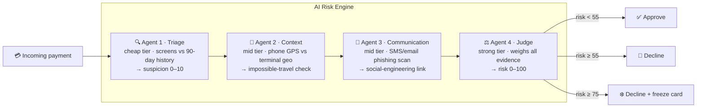

# 🛡️ Bank Risk Control System

**Multi-agent card-fraud detection, with the agents' reasoning on full display.**
A payment arrives → four specialised agents investigate it → the card is approved, declined, or frozen. The web demo lets you *watch every agent think*.

**▶ Live demo:** `https://jason0925pig-rgb.github.io/Bank_Risk_Control_System/` — open it, click a scenario, and watch the pipeline run.

```
python main.py --scenario stolen_wallet
→ 🛑 DECISION: DECLINE + FREEZE   (risk 89/100)
```

---

## Why this project exists

While studying in London, the author had their wallet stolen. Within minutes, the thief tried to rush a **foreign-exchange purchase targeting an African currency** from the stolen card — while the cardholder (and their phone, and three months of spending) had never left London. The issuing bank **froze the card within seconds** and the attack failed.

That instant freeze is a machine making a very good decision very fast. This project is a playable reconstruction of that decision: the flagship scenario replays the exact attack pattern, and the system must catch it from four independent kinds of evidence.

> The agent topology — cheap Triage → Context (GPS) → Communication (phishing) → strong Judge, with cost-aware filtering — was developed and battle-tested during the [Reply AI Agent Challenge 2026](https://github.com/jason0925pig-rgb) fraud-detection track (Langfuse-tracked multi-agent pipeline). This repo is a ground-up rewrite around one synthetic persona, designed to be read, run and demoed.

## How it works

Every incoming payment flows through four agents. Cheap agents run first and filter; the expensive judge only decides cases worth deciding.



| Agent | Question it answers | Key evidence |
|---|---|---|
| **1 · Triage** | Is this worth investigating? | amount vs median spend, category risk, first-time merchant/country, velocity, hour |
| **2 · Context** | Was the cardholder physically there? | haversine distance between phone GPS trail and terminal; >100 km = mismatch, >500 km = **impossible travel** |
| **3 · Communication** | Was the victim manipulated into this? | urgency language + payment demands + typosquatted domains in the 48 h before the charge |
| **4 · Judge** | Final, binding call | weighted evidence → risk score; `<55` approve · `≥55` decline · `≥75` decline **and freeze** |

## The web demo

`index.html` (GitHub Pages) shows a simulated mobile banking app next to a **live agent monitor**:

- **Left — the phone:** account, card, a fabricated 90-day London spending history (Tesco, Thames Water, Octopus Energy, TfL, UCL tuition…), and a "New payment" form (merchant / amount / country / time / where the cardholder's phone is).
- **Right — the war room:** the four agents wake up one by one, stream their reasoning line by line, emit structured output, and the Judge's verdict lands on the phone as a push notification — **❄️ card frozen** for the stolen-wallet case, exactly like the real incident.

Six preset scenarios ship with the demo:

| Scenario | Expected | Engine result |
|---|---|---|
| 🚨 Stolen wallet · Lagos FX bureau | block + freeze | DECLINE + FREEZE (89/100) |
| 🎣 Phishing SMS → £1.99 card test | block | DECLINE (56/100) |
| 🛒 Tesco weekly groceries | pass | APPROVE (3/100) |
| 🔥 Octopus Energy direct debit | pass | APPROVE (3/100) |
| 🎓 Tuition instalment £3,900 | pass (matches instalment 1) | APPROVE (3/100) |
| 🇫🇷 Paris weekend, card-present | pass (GPS follows the trip) | APPROVE (3/100) |

The last two matter as much as the first two: **a risk engine that blocks everything is useless** — big-but-expected tuition and abroad-but-GPS-consistent spending must sail through.

> **Honesty note:** the hosted page replays the *deterministic* engine (the exact rules in [`src/engine.py`](src/engine.py) ported to JS) so it runs with zero API keys. The repo also ships the real LLM implementation ([`src/agents.py`](src/agents.py)) — same four agents, every call traced in Langfuse.

## Quickstart

```bash
# 1 · Deterministic engine — no keys needed
python main.py --list
python main.py --scenario stolen_wallet
python main.py --all

# 2 · Live LLM agents (OpenRouter; Langfuse tracing if keys present)
cp .env.example .env      # fill in OPENROUTER_API_KEY (+ optional Langfuse keys)
pip install -r requirements.txt
python main.py --scenario stolen_wallet --live
```

## Repo layout

```
├── index.html            # the web demo (open directly, or via GitHub Pages)
├── assets/
│   ├── app.js            # deterministic agent engine + UI orchestration
│   ├── data.js           # synthetic persona, 90-day history, scenarios
│   └── style.css
├── src/
│   ├── engine.py         # Python port of the same rules (CLI + baseline)
│   ├── agents.py         # live LLM agents (OpenRouter + Langfuse)
│   └── utils.py
├── data/persona.json     # canonical persona data for the Python side
├── scenarios/*.json      # six runnable scenarios
└── main.py               # CLI
```

## Data provenance

**Every cardholder, transaction, GPS ping and SMS in this repo is synthetic**, authored for this demo. The persona (a CS Master's student in London) is fictional; the spending pattern was designed to be realistic, not copied from anyone. The scenario "stolen wallet · Lagos FX bureau" is a dramatisation of the author's real incident described above, with all details fictionalised.

## 中文简介

**多智能体银行卡风控系统** —— 一笔支付进来,四个分工明确的 AI agent 依次调查它:初筛 agent 对照 90 天消费历史打可疑分;上下文 agent 核对持卡人手机 GPS 与刷卡地点(人在伦敦、卡在拉各斯 = 不可能行程);通信 agent 扫描短信钓鱼话术;裁决 agent 综合证据打出 0–100 风险分,超过 55 拒付、超过 75 直接冻结卡片。

网页演示左侧是模拟手机银行 App(虚构的伦敦留学生账户),右侧是 agent 思考过程实时监控面板。点击"Stolen wallet"场景即可复现作者的真实经历:钱包在伦敦被盗,小偷立刻尝试用信用卡兑换非洲货币,银行秒级冻结——那一次冻结保护了作者,这个项目就是把那个决策过程完整地"晒"出来。

本项目的前身是 Reply AI Agent Challenge 2026 的多智能体反欺诈参赛方案(全链路接入 Langfuse 追踪),这里是围绕单一合成人设的完全重写。仓库内所有人物、交易、轨迹数据均为虚构。

## Roadmap

- [ ] LangGraph migration — supervisor graph with dynamic tool-using agents
- [ ] Labelled synthetic generator → precision/recall eval + per-agent ablation
- [ ] Vishing agent — voice-call fraud (audio) stream, as trialled in the 2026 challenge datasets
- [ ] Live-LLM mode wired into the web demo via a tiny FastAPI sidecar

## License

MIT — see [LICENSE](LICENSE).
